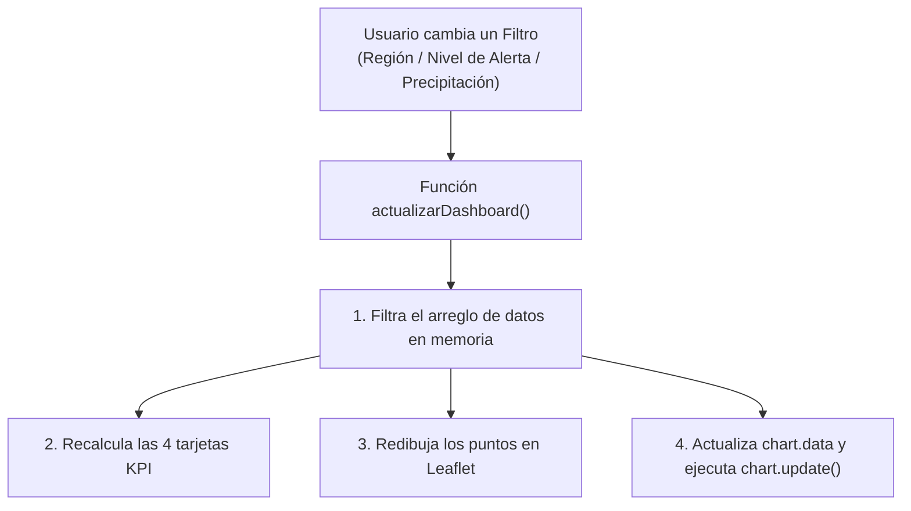

# 📊 Módulo 4: Construcción de Dashboards Geográficos (Leaflet + Chart.js + Turf.js)

- **Duración estimada:** 3.0 Horas
- **Modalidad:** Autodidacta (*Self-Paced*)
- **Entregable del módulo:** [`dashboard-riesgo-territorio.html`](./dashboard-riesgo-territorio.html) (Dashboard interactivo tipo Centro de Monitoreo Territorial y Gestión del Riesgo con 4 KPIs dinámicos, gráficos sincronizados en **Chart.js**, análisis de radio de afectación *Buffer* en el navegador con **Turf.js** y descarga CSV).

---

## 🎯 1. Objetivo de Aprendizaje
Pasar de un simple visor de mapas a un **Dashboard Analítico Integral** capaz de responder preguntas de negocio o gestión pública en tiempo real:
1. Diseñar maquetas tipo *Centro de Control* (100% de la pantalla sin *scroll* desordenado) usando **Tailwind CSS** y *Prompting Visual*.
2. Sincronizar bidireccionalmente **Leaflet.js** y **Chart.js** para que cualquier filtro actualice el mapa, las tarjetas de indicadores (KPIs) y los gráficos estadísticos al mismo tiempo.
3. Ejecutar **geoprocesamiento espacial directamente en el navegador** (sin servidor backend) usando **`Turf.js`** (cálculo de *buffers* y conteo de elementos dentro de un área de impacto).

---

## 🎨 2. Diseño UI/UX con IA Multimodal (35 minutos)

¿Viste un dashboard institucional (del IDEAM, UNGRD, NASA o Esri) cuya distribución de paneles te encantó?
1. Toma una captura de pantalla de ese dashboard.
2. Súbela a **Claude** o **Gemini** junto con este prompt:
   > *"Usa esta imagen como referencia visual de distribución (layout). Crea una estructura equivalente en HTML5 y Tailwind CSS con barra lateral de filtros, fila superior de 4 tarjetas KPI, mapa Leaflet central y dos gráficos de Chart.js a la derecha."*

---

## 🔄 3. El Secreto de la Sincronización Mapa ↔ Gráficos (55 minutos)

Cuando le pidas un dashboard a la IA (ver **Prompt 4.1** en [`PROMPT_PLAYBOOK.md`](../../PROMPT_PLAYBOOK.md)), pídele siempre que implemente una única función maestra llamada `actualizarDashboard()`:

---

## 📐 4. Análisis Espacial en el Navegador con `Turf.js` (45 minutos)

Normalmente, para hacer un **Buffer (Área de Influencia)** o un **Conteo de Puntos en Polígono** necesitarías QGIS, PostGIS o Python. Con **`Turf.js`**, la IA puede programarlo dentro del mismo archivo HTML:

1. Abre [`dashboard-riesgo-territorio.html`](./dashboard-riesgo-territorio.html).
2. En la barra lateral izquierda, activa el interruptor **"⭕ Modo Radio de Afectación (Turf.js)"** y elige un radio en kilómetros (ej. `180 km`).
3. Haz clic en cualquier punto del mapa de Colombia: verás cómo `Turf.js` dibuja el polígono circular exacto y calcula al instante cuántas estaciones caen dentro del radio de emergencia y su precipitación promedio.

---

## ✅ 5. Reto de Autoevaluación del Módulo 4

- [ ] Prueba filtrar por la región **Caribe** o **Amazonía** en [`dashboard-riesgo-territorio.html`](./dashboard-riesgo-territorio.html) y verifica que los 4 KPIs superiores y los 2 gráficos derechos cambien instantáneamente.
- [ ] Descarga los datos filtrados con el botón **"⬇️ Exportar Filtrados (CSV)"**.
- [ ] Pídele a la IA que agregue un tercer gráfico o cambie el gráfico de dona por un gráfico polar (`polarArea`) en Chart.js.

👉 **[Ir al Módulo 5: Aplicaciones Web Analíticas con Python y Streamlit](../modulo-5-streamlit-python-apps/README.md)**

